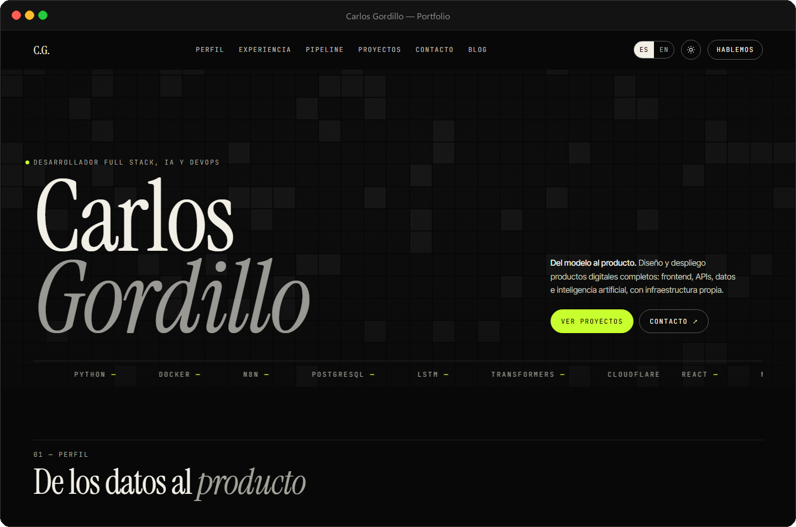

# Carlos Gordillo — Portfolio

Personal portfolio for Carlos Gordillo, a full stack and AI developer. Profile, experience,
projects with real screenshots, an animated CI/CD pipeline and a bilingual blog.

**[Live site](https://carlosgordillo.com)**



## What it does

- Bilingual Spanish/English site with the language stored in `localStorage`
- Light and dark themes, switchable from the header and persisted per visitor
- Draggable project rail with screenshots of four deployed apps, linked to their repositories
- Animated CI/CD pipeline demo with eight stages, pause on scroll and reduced-motion support
- Blog with index and article pages, plus a translated 404 page
- Responsive layout with a full-screen mobile menu

## Stack

React 19 · TypeScript · Vite 7 · react-router-dom 7 · i18next · CSS variables

## Run locally

```bash
npm install
npm run dev       # http://localhost:5173
npm run build     # generates dist/
npm run preview
```

## Structure

```
public/               favicon, profile photo, project screenshots, _redirects
src/
├── components/       Hero, KineticCanvas, Marquee, About, Stat, Experience,
│                     Pipeline, Projects, Contact, Header, LanguageSwitch,
│                     ThemeToggle, MobileMenu, Footer, Reveal
├── pages/            Home, Blog, BlogPost, NotFound
├── locales/          es.json, en.json — all editable copy
├── content/          blog.ts, projects.ts, pipeline.ts
└── styles/           kinetic.css (visual system) and pipeline.css
```

## Deployment

The site is a static SPA. On Vercel the default Vite preset works: build `npm run build`,
output `dist`. `vercel.json` rewrites every path to `index.html` so `/blog` and
`/blog/:slug` survive a hard refresh. `public/_redirects` does the same on Netlify and
Cloudflare Pages.

## Notes

All content lives in `src/locales` and `src/content`; there is no API, database or
authentication behind the site. The pipeline section is an illustrative animation, not a
live CI/CD feed, and the project screenshots are local captures of the deployed apps.
